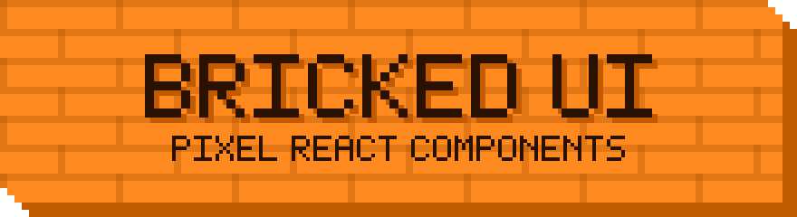

<p align="center">
  
</p>

<p align="center">
  <b>A pixel-art UI kit built from orange bricks.</b><br>
  A chunky pixel-art kit for React and Svelte apps. Pick any of the 91 pieces — or the 51-piece Svelte registry — paste it into your project, and ship something with character.
</p>

<p align="center">
  
  
  
</p>

<p align="center">
  <a href="https://bricked-ui.vercel.app"><b>Live demo</b></a> ·
  <a href="https://github.com/bricked-ui/ui/blob/main/DESIGN.md"><b> Design guide </b></a>
  <a href="#components"><b>Components</b></a> ·
  <a href="#contributing"><b>Contributing</b></a>
</p>

🟧🟧🟧🟧🟧🟧🟧🟧🟧🟧🟧🟧🟧🟧🟧🟧🟧🟧🟧🟧

## What is this?

Bricked UI is a set of small, copy-and-own React components with one strong look:

- **Brick-orange faces** with a faint mortar pattern drawn in pixels
- **Two cut corners** on every surface (top-right and bottom-left), made with a stepped `clip-path`
- **Hard bevels** instead of borders or shadows: raised on the bottom/right, sunken on the top/left
- **Pixel icons** drawn on a grid, so they stay sharp at any size
- **Steps-only animation**, so nothing ever eases or blurs

Every component is its own file. Copy the ones you want, like you would with shadcn/ui.

🟧🟧🟧🟧🟧🟧🟧🟧🟧🟧🟧🟧🟧🟧🟧🟧🟧🟧🟧🟧

## Quick start

```bash
# 1. copy the kit into your project
cp -r src/ your-app/src/bricked/

# 2. import the stylesheet once (it loads Press Start 2P and VT323 from Google Fonts)
```

```jsx
import "./bricked/bricked.css";
import { Button, Card, Field, Input } from "./bricked";

export default function App() {
  return (
    <div className="bricked-ui">
      <Card title="Welcome">
        <Field label="Name" id="name">
          <Input id="name" placeholder="Your name" />
        </Field>
        <Button icon="rocket">Launch</Button>
      </Card>
    </div>
  );
}
```

> Wrap your app (or any part of it) in `className="bricked-ui"` so text picks up the body font and the ink color.

🟧🟧🟧🟧🟧🟧🟧🟧🟧🟧🟧🟧🟧🟧🟧🟧🟧🟧🟧🟧

## Components

Each one lives in `src/<name>.jsx`.

### Actions

| Component | Import | Notes |
|---|---|---|
| Button | `Button` | `size` sm / md / lg, `icon`, `iconPosition` |
| Icon button | `IconButton` | square, needs `label`, optional notification `dot` |
| Like button | `LikeButton` | heart toggle with a pixel burst |

### Containers

| Component | Import | Notes |
|---|---|---|
| Card | `Card` | brick-orange header with `title` |
| Modal | `Modal` | closes on backdrop click and Esc |
| Alert | `Alert` | dark box with a pixel `!` |
| Toast | `Toast` | optional auto-dismiss with `duration` |
| Banner | `Banner` | dismissible orange strip |
| Stat | `Stat` | big orange number on dark |
| Empty state | `EmptyState` | big pixel icon, message and action |
| Divider | `Divider` | dashed pixel line with a label |
| Code block | `CodeBlock`, `Kw`, `Str` | dark block with orange keywords |
| Table | `Table` | brick header row |

### Forms

| Component | Import | Notes |
|---|---|---|
| Field | `Field` | label + control wrapper |
| Input | `Input` | sunken field, orange focus ring |
| Textarea | `Textarea` | same look, resizable |
| Search | `Search` | pixel magnifier inside the input |
| Select | `Select` | native select with a pixel arrow |
| Checkbox | `Checkbox` | pixel check mark |
| Radio | `Radio` | octagon with a pixel dot |
| Switch | `Switch` | Off / On segmented toggle |
| Slider | `Slider` | orange fill, dark block thumb |
| Counter | `Counter` | minus / plus around a number |
| Rating | `Rating` | five pixel stars |
| Dropzone | `Dropzone` | click-to-pick file box |
| Chips | `Chips` | removable tags |
| Keys | `Keys` | keycap combos like Ctrl + K |

### Navigation and selection

| Component | Import | Notes |
|---|---|---|
| Tabs | `Tabs`, `TabPanel` | selected tab is brick orange |
| Accordion | `Accordion` | one item open at a time |
| Menu | `Menu` | dark dropdown, closes on Esc |
| Tooltip | `Tooltip` | shows on hover and focus |
| Breadcrumbs | `Breadcrumbs` | pixel arrows between links |
| Pagination | `Pagination` | square page buttons |
| Stepper | `Stepper` | done / current / todo steps |
| List group | `ListGroup` | selectable rows |
| Calendar | `Calendar` | Monday-first month grid |
| Timeline | `Timeline` | square markers on a vertical line |
| Avatar | `Avatar` | initials or a pixel icon |
| Badge | `Badge` | orange or `dark` |

### Feedback and loading

| Component | Import | Notes |
|---|---|---|
| Progress | `Progress` | segmented orange bar |
| Meter | `Meter` | game-style life bar |
| Spinner | `Spinner` | ring of small cubes that blink in turn |
| Brick stack | `BrickStack` | three bricks drop in one by one |
| Skeleton | `Skeleton` | pulsing placeholder |

### Fun

| Component | Import | Notes |
|---|---|---|
| Wall | `Wall` | click to lay bricks and build a wall |
| Dice | `Dice` | pixel die that rolls |
| Typewriter | `Typewriter` | types out text with a blinking cursor |
| Launcher | `Launcher` | rocket flies through a starry sky |
| Fortune | `Fortune` | ask the wall a question |
| Clock | `Clock` | live pixel clock |

🟧🟧🟧🟧🟧🟧🟧🟧🟧🟧🟧🟧🟧🟧🟧🟧🟧🟧🟧🟧

## Pixel icons

Icons are plain text grids. A `1` is a filled pixel.

```js
rocket: [
  "0001000",
  "0011100",
  "0010100",
  "0011100",
  "0111110",
  "1101011",
  "0001000",
],
```

```jsx
<Button icon="rocket">Launch</Button>
<PixelIcon name="heart" size={5} />
```

Built in: `play` `plus` `minus` `check` `arrow` `heart` `star` `download` `upload` `home` `rocket` `cart` `dot` `down` `right` `left` `alert` `close` `user` `search`

Add your own in `src/pixel-icon.jsx`. Keep strokes one pixel thick and skip anti-aliasing.

🟧🟧🟧🟧🟧🟧🟧🟧🟧🟧🟧🟧🟧🟧🟧🟧🟧🟧🟧🟧

## Design tokens

| Token | Value | Used for |
|---|---|---|
| `ink` | `#2b1100` | text, dark surfaces, focus rings on orange |
| `shade` | `#c25a00` | bevels, sunken edges, connectors |
| `orange` | `#ff8a1f` | selected and primary faces |
| `field` | `#fff6ea` | inputs, tracks, cream surfaces |
| `peach` | `#ffd3a1` | cards and modals |

**Sizes.** Everything is a multiple of one pixel unit:

| Size | `--px` | `--cut` | `--icon` | Font |
|---|---|---|---|---|
| sm | 4px | 1.5px | 3px | 11px |
| **md** | **6px** | **2px** | **4px** | **14px** |
| lg | 8px | 3px | 5px | 18px |

**Fonts.** [Press Start 2P](https://fonts.google.com/specimen/Press+Start+2P) for buttons, labels and headers. [VT323](https://fonts.google.com/specimen/VT323) for body text and inputs.

The full list of colors, bevel recipes and per-component measurements is in the [style guide](./BRICKED-UI-STYLE-GUIDE.md).

🟧🟧🟧🟧🟧🟧🟧🟧🟧🟧🟧🟧🟧🟧🟧🟧🟧🟧🟧🟧

## The brick rules

1. **No `border-radius`. Ever.**
2. **Two cut corners** per surface, top-right and bottom-left, as a 4-step staircase.
3. **No borders, no blur.** Depth comes from hard inset shadows only.
4. **Raised** = shade on the bottom/right. **Sunken** = shade on the top/left. **Dark** = ink with a `#000` bevel.
5. **Selected means orange brick:** orange face, mortar pattern, raised bevel, ink text.
6. **Text on orange is always ink.** Never white.
7. **Focus rings are drawn inside** the element, because `clip-path` would clip an outline.
8. **Animation uses `steps()` only.** No smooth easing, no transitions.
9. **Everything snaps to the pixel unit.**

🟧🟧🟧🟧🟧🟧🟧🟧🟧🟧🟧🟧🟧🟧🟧🟧🟧🟧🟧🟧

## Tailwind

The kit ships as plain CSS. A Tailwind version is described in section 7 of the [style guide](./BRICKED-UI-STYLE-GUIDE.md): theme colors, custom utilities for the cut corners and brick pattern, and a `cva` button example.

## Accessibility

- Real `<button>`, `<input>`, `<select>` and `<label>` elements
- Roles and ARIA on custom controls (`switch`, `tab`, `dialog`, `progressbar`, `tooltip`)
- Visible focus on every control
- Icon-only buttons need a `label`
- Loaders and click-triggered effects keep moving under reduced-motion settings. Only the idle skeleton pulse and caret blink are turned off.

## Browser support

Needs `clip-path: polygon()` with `calc()`, CSS custom properties and `:focus-visible`. That is every current version of Chrome, Edge, Firefox and Safari.

**Known limit:** `clip-path` clips anything that overflows a component. Keep tooltips and menus inside their card, and render modals outside any card.

## Project structure

```
bricked-ui/
├─ assets/
│  └─ banner.svg
├─ src/
│  ├─ bricked.css        # all tokens and component styles
│  ├─ index.js           # exports every component
│  ├─ pixel-icon.jsx     # icon grids + <PixelIcon />
│  ├─ button.jsx
│  ├─ card.jsx
│  └─ ...                # one file per component
├─ BRICKED-UI-STYLE-GUIDE.md
└─ README.md
```

🟧🟧🟧🟧🟧🟧🟧🟧🟧🟧🟧🟧🟧🟧🟧🟧🟧🟧🟧🟧

## Contributing

Adding a component? Run through this list first:

- [ ] Pick the role: raised, sunken or dark
- [ ] Use `--px`, `--cut` and `--icon` from the size table
- [ ] Add the cut corners with `bk-cut`
- [ ] Use the right bevel for the role
- [ ] Press Start 2P for chrome, VT323 for content
- [ ] Add hover, active, focus (inside) and disabled states
- [ ] Draw icons on a 7×7 grid or larger, with no anti-aliasing
- [ ] Animate with `steps()` only
- [ ] Check nothing relies on overflowing outside the clipped box

## Credits

- Fonts: Press Start 2P and VT323, both under the SIL Open Font License
- GitHub icon: a pixel trace of the GitHub mark

## License

MIT. Replace this with your own license and add a `LICENSE` file before you publish.

<p align="center">
  🟧 Built one brick at a time 🟧
</p>
